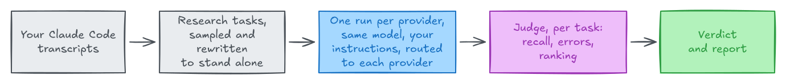

# my-search-eval

Which search provider makes Claude more useful for you, judged on your own past research.

Public search benchmarks use someone else's questions. Your best provider depends on what you research: docs and changelogs, prices, papers, news. This Claude Code plugin replays the research you already did in Claude Code on Exa, Parallel and Claude Code's built-in search, has Claude judge the answers blind, and recommends one provider with the reasons.

One command. About 14 minutes (`--quick`) to 25 minutes in the background. Runs on your Claude subscription.

## What you get

An example (invented numbers):

```
Which search provider makes Claude more useful for you
30 of your 412 research tasks, Sep 2 to Nov 20, 2026 (21 sessions), replayed Nov 23

Verdict
  Use Exa. Its answer was ranked first on 14 of 30 tasks, more than any other provider, and its
  results held the most of what your answers needed (recall 3.1 of 4). Parallel is the
  runner-up. Both are free at your volume.

  per task        ranked best  recall errors (main / side)    monthly cost  context tokens  time
  Exa                   14/30   3.1/4             3% / 10%  $0 (free tier)            ~38k  71 s
  Parallel              11/30   2.9/4             3% / 13%  $0 (free tier)            ~29k  64 s
  built-in search        5/30   2.2/4            10% / 17%              $0             ~9k  88 s

Head to head
  Exa above Parallel                 16/30
  Exa above built-in search          24/30
  Parallel above built-in search     22/30

Why
  With Parallel instead, you'd have:
  - [Recall] missed the vendor's current pricing page, such as the per-seat price change (task 7)
  - [Side errors] been told a deprecated flag still works (task 19)
```

`report.html` (opened when the run ends) has every task, the judge's notes and the method, and for each provider its full answer and every tool call: the input, the pages it returned (rank, title, date, and whether the answer cited it), the start of the raw result (2,000 characters), and any error, rate limit or empty result. `results.jsonl.gz` next to it holds the same with each result's text up to 100,000 characters, the tools each provider offered, and request ids ([schema](docs/results-schema.md)), for anyone who wants to dig in, such as a provider's engineers if you choose to share it (see [Your data](#your-data) first).

## Install

```
/plugin marketplace add vinidlidoo/my-search-eval
/plugin install my-search-eval@my-search-eval
```

Then:

```
/my-search-eval:run --quick    # 10 tasks; start here
/my-search-eval:run            # 30 tasks
```

Options:
- `--model M`: run every call on model M (default: your default model).
- `--no-instructions`: leave your CLAUDE.md out of the replays.
- `--keep-logs`: keep the raw logs of every run (run folders are still deleted after 60 days).
- `--resume`: continue a stopped or paused run with its original options (other flags are ignored).
- `--purge`: delete the cache and all raw logs, keeping the reports (and each run's config, so the 60-day cleanup still applies).
- `--diagnose`: write and show `diagnostics.md` for the latest run (see [If something fails](#if-something-fails)).

Needs:
- Claude Code with the `claude` CLI on your PATH (tested with 2.1.331);
- Python 3.9+ (standard library only);
- a Claude subscription login (Pro, Max, Team or Enterprise), not an API key or a cloud provider;
- at least 10 research tasks in your transcripts (past sessions where Claude searched the web), from at least 4 sessions within Claude Code's transcript window (30 days by default);
- optionally, the GitHub CLI (`gh`), only to file an issue.

Tested on macOS only; Linux and WSL should work but are untested. Not native Windows.

## Time and usage

| | Tasks | Model runs | Wall time |
|---|--:|--:|--:|
| `--quick` | 10 | about 50 | about 14 minutes |
| default | 30 | about 135 | about 25 minutes |

Usage counts against your plan's limits, with no API charges. The plan, with these numbers for your run, prints as the run starts.

- **Max:** a full run fits easily.
- **Pro:** start with `--quick`, or use `--model sonnet` for less usage. A full Opus run can use a large share of your weekly limit.
- **Team:** as Pro or Max, depending on your seat.
- **If you hit a usage limit,** the run pauses. `/my-search-eval:run --resume` continues after the limit resets, skipping finished work.

**While it runs.** The work runs in a background process, so you can keep using the session; Claude reports each phase (instructions, build, replay, judge, report) and shows the summary at the end. You can also close the session: the run continues, and `/my-search-eval:run` shows its progress, or the summary once it's done.

## Your data

Everything is written to `~/.claude/my-search-eval/` on your machine, readable only by your account (folders 0700, files 0600, like Claude Code's own transcripts). What leaves it:

- **Your instructions.** Your whole user `~/.claude/CLAUDE.md`, with the files it imports (`@path`), goes into every replay's system prompt, with its web-tool lines pointed at the provider under test. `--no-instructions` leaves it out.
- **Task text** is written from your transcripts by Claude (the task builder), told to leave out private details. A code check then drops any task that still holds an email address, a local path, your username or one of your project folder names (5 or more characters, common names like `code` or `work` excepted).
- **Search providers** get the replays' search queries and fetched URLs: Exa, Parallel, Anthropic's built-in search, and the sites fetched. They also see your IP address.
- **Claude calls** (task building, replays, the judge, the report) run on your own login, like any Claude Code session.

What stays local:

- **Transcripts** are read from `~/.claude/projects`. A delegation that points to a brief file has it read only from `~/.claude` or that session's project folder.
- **Runs:** `~/.claude/my-search-eval/runs/<timestamp>/`, with `runs/latest` pointing at the newest. Each holds the reports (`report.html`, `report.md`, `terminal.txt`), the export (`results.jsonl.gz`), and the run's `config.json` and `progress.json`.
- **The export** (`results.jsonl.gz`) stays on your machine; the plugin never sends it anywhere. Sharing it is your choice. It holds ([schema](docs/results-schema.md)):
  - your task text;
  - tool inputs as Claude wrote them: search queries, URLs and fetch prompts;
  - the results each provider returned (each cut at 100,000 characters), and each provider's answer;
  - the judge's notes, which quote the task;
  - record ids, linking each task to the search call in your transcript;
  - the lines of your CLAUDE.md rewritten to point at each provider;
  - per-call times and provider request ids, which let a provider match rows to its own logs.

  Your home folder shows as `~`, and your username in paths as `<user>`. Review it before sharing: answers and queries can echo your CLAUDE.md context. The same goes for the reports, which show the answers and tool calls too.
- **Cache:** `~/.claude/my-search-eval/cache/` holds Claude's writing calls: your instructions rewritten per provider, and the verdict and Why text, which quote task text. It makes re-rendering a report free.
- **Retention,** applied as each run starts: run folders are deleted 60 days after the run, except your most recent run, which is always kept. Raw logs (your harvested tasks, replay logs, grades) are kept only for your last 3 runs, unless you pass `--keep-logs`. Cache entries unused for 60 days are deleted. The run you could resume (the latest), and one a worker is still running, are never touched; an older paused run ages out like any other. The terminal says what was deleted.
- **Delete it all:** `/my-search-eval:run --purge` removes the cache and every raw log (reports and run configs stay, and still expire after 60 days); delete `~/.claude/my-search-eval` to remove the reports too.

Safety:

- **Billing.** Every Claude call runs with API keys, auth tokens and cloud-provider settings removed from its environment. Before anything runs, and again in the background worker, the plugin checks `claude auth status` and refuses an API key, an `apiKeyHelper` or a cloud provider.
- **Replays** have web search and fetch only, plus read access to their own project folder, where Claude Code saves their long results. They can't read your files or other sessions' saved outputs, and have no shell or file edits. They run from an empty temp folder and aren't saved as sessions, and the project folder Claude Code makes for that temp folder is removed afterwards.

## If something fails

When a run fails or stops unexpectedly, it writes `diagnostics.md` to the run folder (`/my-search-eval:run --diagnose` writes it on demand). It's built only from a fixed list of fields: versions (plugin, Claude Code, Python, OS), the failing phase, the exception type, stack frames (file, line, function), progress and task counts, per-provider connection, rate-limit and failure counts, your flags, and the retention summary. It never holds task text, queries, URLs, answers, results, judge notes, your CLAUDE.md, paths or your username.

Nothing is sent automatically. Claude shows you the file and asks whether to open an issue. On yes, it files it with `gh issue create` if the GitHub CLI is logged in (you approve the command), or gives you a pre-filled link to review and submit yourself. You can also open an issue by hand with the bug template.

## How it works



1. **Harvest.** Find every research task in your transcripts: the web searches Claude ran (built-in WebSearch, or Exa, Parallel, Firecrawl or webclaw search) for one request or one subagent, with the context around them. Other search tools aren't recognized.
2. **Sample and build.** Pick tasks at random, at most 3 per session. Claude rewrites each as a self-contained question and drops tasks whose premise has expired (live results, passed deadlines) or that have no fair public question. The run needs at least 10 before it starts. Tasks lost later (an MCP server that didn't connect, a rate-limit stop, a run or judge call that failed) are left out, so a report can cover fewer; it says how many and why.
3. **Replay.** Each task runs once per provider as a fresh headless Claude Code session, 3 at a time, with the same model and your user CLAUDE.md (its web-tool lines routed to each provider). Replays have no project CLAUDE.md, skills, plugins, hooks or other MCP servers, web tools only, and 15 minutes at most, so the provider is the only thing that changes. A replay that didn't connect or finish, or that hit a rate limit, is rerun once; if it fails again, the task is left out.
4. **Judge.** One Claude call per task, on the same model that ran the tasks, with provider and tool names and request ids removed. Before grading the answers, it lists what a complete answer needs from all providers' evidence together. It grades each provider's **recall** (how much of that its results held, 0 to 4) and **errors** (where its answer departs from the evidence, on the main point or a side point), and **ranks** the answers by helpfulness. The ranking decides each task; recall and errors explain it. A task whose judge call fails twice is left out.
5. **Report.** One Claude call weighs every metric into the verdict: ranks, recall, errors, cost after free tiers at your volume (research tasks per month, estimated from your transcripts), context tokens and time. Code checks that it cites only numbers in its input. The Why bullets name what you'd have missed with the runner-up or the other provider, and where that provider did better, each checked against the judge's notes; with too few tasks, there is no Why section and the report says so.

The providers:

- **Exa** and **Parallel** run keyless, configured as their docs install them in Claude Code (checked 2026-11-18): their free keyless HTTP MCP servers, which need no account or API key, added to each replay on the command line. Nothing is installed into your Claude Code setup.
- **Built-in search (Anthropic)** (`WebSearch` and `WebFetch`) is the **baseline**: the provider the others are compared against. The MCP replays keep it available too, as in a real session.

## Limits

- **Your tasks only.** The verdict reflects your questions and the web on the day you run it.
- **Small samples.** Up to 10 or 30 tasks (fewer if some are lost during the run), one run per provider per task, no error bars: a few tasks can swing a close call.
- **The judge is Claude,** because Claude is the one reading search results. No human grading.
- **The runs are recognizable by format.** Each provider's results look different (Parallel's JSON, Exa's text blocks, built-in search's summaries), so the judge can tell the runs apart, though it isn't told which provider is which.
- **Keyless tiers are rate-limited.** A full run makes about 100 calls to each provider. A replay refused by a provider's keyless rate limit is rerun once; once that provider has refused two replays in the run, replaying stops and the report covers the tasks finished, instead of waiting for the limit to reset, and says so. A Claude usage limit is different: the run pauses, and `--resume` continues it. The eval runs keyless only; for your everyday use, a free API key lifts the limits.
- **Unpriced tools.** Cost covers each provider's priced search and fetch tools. Calls to other tools (for example Parallel's vertical search) aren't priced; the report says how many there were.
- **Fetched pages are untrusted.** A page could try to steer a replay. Replays have no shell and can read only their own saved results, so it can't reach your files.
- **Claude Code transcripts only.** Claude Code deletes transcripts after 30 days by default; raise `cleanupPeriodDays` in `~/.claude/settings.json` to keep more.

## Development

```
python3 -I -m unittest discover -s tests   # offline: a fake `claude` stands in for every model call
claude plugin validate --strict .
```

Test-only options (`--home`, `--projects`, `--cache-dir`, `--tasks`, `--no-open`, `--foreground`) and `MY_SEARCH_EVAL_HOME` and `MY_SEARCH_EVAL_FAIL` need `MY_SEARCH_EVAL_DEV=1`. Running `scripts/report.py` directly re-renders a run's report (a developer tool); it writes owner-only files too.

MIT license.
